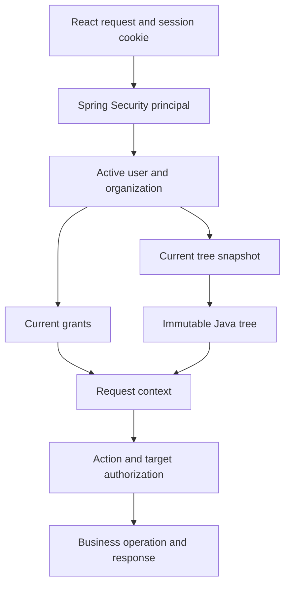

# Permissions Engine Development Brief

Version 1.0 | 10 November 2026 | Architecture baseline for human developers and AI coding agents

This brief consolidates the proposed React, Spring Boot, and Neon PostgreSQL workflow. It establishes the intended design and implementation boundaries; it does not describe an already implemented system. The application stores users and grants relationally, stores management relationships in append-only JSONB snapshots, and constructs an immutable tree in Java for authorization. An MVP identity selector will later be replaced by verified authentication.

## 1 Design goals and scope

- Support approximately 100 users during the first production year, with an anticipated ceiling of 500–1,000 nodes and typical maximum depth of 6–7.
- Keep individual user retrieval independent of loading the management hierarchy.
- Make management scope checks inexpensive in the backend without requiring SQL recursion for each request.
- Preserve complete hierarchy history and restore prior content by publishing a new version.
- Prevent stale edits, unauthorized hierarchy changes, cross-organization access, and accidental privilege escalation.
- Keep authentication replaceable without changing internal user identifiers, hierarchy documents, or permission rules.
- Favor a small, understandable implementation over distributed caching or specialized hierarchy infrastructure.

Breadth chiefly affects descendant enumeration and response size. At this scale, a full tree load and O(n) Java index construction are reasonable starting assumptions, subject to measurement. Table count alone is not a capacity estimate.

## 2 Decisions and proposed defaults

| Area | Baseline | Status |
| --- | --- | --- |
| Application stack | React frontend and Spring Boot backend | Established |
| Database | PostgreSQL hosted on Neon | Working direction |
| User records and grants | Relational tables on the same database | Established direction |
| Management hierarchy | Plain JSONB, one complete snapshot per version | Established direction |
| History | Append new rows; do not edit or delete snapshots through the application | Established direction |
| Encryption | No application-level payload encryption initially | Established direction |
| MVP identity | Server-controlled demo user selector | Established direction |
| Session | Server-side cookie session; one selected identity per browser session | Recommended default |
| Document format | Flat map of user IDs to manager IDs | Recommended default |
| Tree caching | Immutable parsed trees keyed by tree ID and version | Recommended default |
| Freshness | Read current version for each protected request | Recommended MVP default |
| Deployment | One backend instance initially; React and API under one origin | Recommended MVP default |

JSONB is selected for document snapshots and backend-oriented processing, not because relational storage prevents custom Java logic. Either persistence format could feed the same Java tree. Plain JSONB allows SQL inspection and custom validation; database operators with sufficient privileges can read it. Its contents parallel the existing org chart, so publishing integrity matters more here than adding payload encryption.

## 3 System boundaries

React submits user intent, displays context and results, and maintains presentation state. It never connects to Neon, supplies database credentials, or determines authoritative permissions.

Spring Security resolves the session principal. Application services load current user state, grants, and hierarchy; construct request context; authorize the exact action and target; and execute operations.

Neon stores relational records and immutable JSONB snapshots. PostgreSQL constraints, restricted roles, and a controlled append operation enforce persistence rules. Database access is exclusively through the backend and authorized operational tooling.



## 4 Data model

The following entities describe responsibilities, not a required final table count. Add resource-specific tables according to the existing application model.

| Entity | Essential fields | Responsibility |
| --- | --- | --- |
| app_user | id, organization_id, display_name, status | Stable internal identity and current account state |
| organization | id, name | Organization boundary if needed |
| management_tree_head | tree_id, organization_id, current_version | Stable lock target and current published version |
| management_tree_snapshot | tree_id, version, structure, schema_version, created_at, created_by, reason, restored_from_version | Append-only complete hierarchy history |
| Role and grant entities | user/role IDs, action, resource scope | Explicit permissions and delegation limits |
| external_identity | issuer, subject, user_id | Future provider identity mapping |

Use a composite primary key on snapshots `(tree_id, version)`. The head identifies its current snapshot; prefer a composite foreign key where practical. Keep IDs consistently typed, preferably UUIDs. Examples use shortened strings only for readability. Snapshot audit actors reference stable retained identities; prefer deactivating users over hard deletion.

The head row is mutable internal metadata. The snapshot history is append-only. If strict avoidance of any UPDATE is required, use a transaction-level advisory lock and query the latest snapshot instead; this is an alternative, not an additional write path. All publishers must use the same locking protocol.

### Snapshot payload

```json
{
  "managerByUser": {
    "u100": null,
    "u101": "u100",
    "u102": "u100",
    "u103": "u101"
  }
}
```

Store only relationships. Keep names, emails, account state, and permission grants outside this payload. Each included user has one entry; null means a root. Decide whether the organization has one root or permits a forest before implementation. Store the payload schema version in the snapshot envelope and support explicit evolution of older versions.

Historical snapshots can reference users who later become inactive. Historical validity must not require every referenced user to remain active forever. New publication and restoration must validate against current policy.

## 5 Identity and session workflow

1. React obtains a backend-controlled list of selectable demo identities.
2. React submits `POST /api/dev/session` with the selected user ID and CSRF protection.
3. The backend checks that demo mode is enabled, the user is selectable, and the account is active.
4. Spring Security establishes the principal using its session authentication facilities, applies session fixation protection, and persists the security context.
5. The browser receives an HttpOnly session cookie. Use Secure over HTTPS and an appropriate SameSite policy.
6. React fetches `/api/me/context` and renders the user's capabilities.

The selector simulates identity; it does not verify ownership of an account. Enable it only in an isolated demo environment with demo data. It must be disabled by default and absent or denied in verified production mode. Do not accept an arbitrary user ID header as identity on normal API requests.

Keep the session principal small: internal user ID and authentication mode. Do not keep a long-lived copy of grants or the entire tree as authoritative session state. Spring Security's SecurityContext and the application's RequestContext have distinct responsibilities.

Switching identity replaces the session identity, clears React's user-specific query caches, and reloads context. An existing in-flight request retains the identity it started with; React must cancel or ignore stale responses after switching. One browser session has one identity, including across tabs. Logout invalidates the session and clears client state.

## 6 Protected request and context workflow

1. Resolve the principal from the session; return 401 if absent or expired.
2. Load the current user and organization; reject inactive users and terminate their session according to policy.
3. Load current explicit grants and role assignments.
4. Resolve the organization's tree and current version from the primary database.
5. Reuse the immutable tree cache entry for that exact version, or load and parse its snapshot.
6. Build a request-scoped context from this user, grants, and tree.
7. Authorize the endpoint action against the actual target user or resource.
8. Execute the business operation and return a purpose-specific DTO.

User records and JSONB documents are complementary inputs, not alternatives. Load the user first so the backend establishes the organization rather than trusting a client-supplied organization ID.

Example conceptual context:

```java
record RequestContext(
    UUID userId,
    UUID organizationId,
    AuthenticationMode authenticationMode,
    long treeVersion,
    Set<String> permissions,
    ManagementTree tree
) {}
```

Use immutable collections, including child lists. A Java record alone does not make contained collections immutable. Treat context as request-scoped; do not share mutable user context across requests or threads.

Read user state, grants, and tree references from a coherent database snapshot where consistency across those inputs is required. Multiple queries at the default READ COMMITTED level can observe different committed states. A read-only REPEATABLE READ transaction is a reasonable context-loading option. Sensitive writes require the additional coordination described below.

## 7 Tree construction and permission semantics

Parse with Jackson into a defined DTO, validate, and derive:

- `managerByUser`: user ID to immediate manager ID.
- `reportsByUser`: manager ID to immutable direct-report IDs.

Construction is O(n). To check whether actor A manages target B, follow B's parent links upward: O(d) in a valid tree. To list a subtree, traverse its child links: O(k) for the visited nodes. A missing node or invalid traversal must not grant management authority.

The baseline authorization rule is:

```text
actor is active
AND actor and target belong to the permitted organization
AND actor has the required action permission
AND target falls within the actor's allowed scope
AND any proposed grant falls within actor's delegable authority
```

Management relationships define scope. Explicit grants define actions. Management does not automatically grant every resource permission held by a report. Decide self-management, administrator overrides, explicit denials, and inheritance rules before implementing them; default unspecified privileged actions to denied.

When a report list needs user details, batch or page relational user retrieval. Do not make one database query for every tree node or traverse lazy JPA entities recursively.

## 8 Snapshot publishing and restoration

Use one controlled database append function behind a Spring service. A proposed request includes `expectedVersion`, proposed structure, and a reason; derive actor identity from the server principal.

Recommended transaction protocol for the head-row design:

1. Lock the stable head row with `SELECT ... FOR UPDATE` using READ COMMITTED semantics and consistent lock ordering.
2. Read its current version after acquiring the lock.
3. Reject a mismatched expectedVersion with 409 Conflict. Do not silently rebase or renumber a stale full document.
4. Recheck the actor's current publication authority and validate the proposed diff against the current snapshot.
5. Validate payload structure, membership, roots, cycles, and organization rules.
6. Insert snapshot `currentVersion + 1`; record server-derived actor and timestamp.
7. Update the head pointer and commit atomically.
8. Return the committed version. Future requests discover it through the head.

All relationship publication paths, including restoration and administrative imports, must follow this protocol. A trigger computing MAX(version) + 1 alone does not prevent stale-content replacement or concurrent allocation conflicts. A normal sequence does not guarantee gapless committed versions. Initial tree creation must also enforce unique tree identity; recommended initialization creates the head and version 1 atomically.

Publication validation must reject missing/currently ineligible users according to policy, cross-organization links, self-parenting, cycles, invalid roots, duplicate membership, and unsupported payload versions. Define whether every active user must appear or whether unplaced users are permitted. Use strict parsing to reject duplicate JSON object keys before JSONB conversion, since conversion may discard that evidence. Validate size and node limits at the API boundary.

Restoring version 8 when the current version is 12 creates version 13 containing revalidated version-8 relationships. Set restored_from_version to 8. Do not decrement the head or edit old snapshots. Restoration can reinstate management authority, so authorize and review its effective relationship changes like any publication.

User activation, organization changes, and deactivation must coordinate with publication when they affect current-tree validity. Retain historical user IDs. Do not assume a user foreign key inside JSONB is enforced automatically.

## 9 Consistency and cache policy

Cache parsed trees by `(treeId, version)` with a bounded size. For the MVP, query the current head version on each protected request; load the full JSONB only on cache miss. Do not introduce Redis, TTL-based authority caches, or notification infrastructure without a measured need.

A request can use the committed tree version it observed. For hierarchy-sensitive mutations, establish stronger ordering: acquire a shared lock on the head before final authorization and hold it through the business transaction. Publishers acquire an exclusive row lock. Consequently, the mutation either completes before the hierarchy publication or checks the newly published version. Acquire coordination locks before building the final write context and use a documented transaction/isolation protocol; do not assume a read-only snapshot alone prevents a concurrent revocation.

Permission-grant revocation and user deactivation require equivalent ordering if immediate enforcement is required. A head lock only coordinates writers that participate in that protocol. Define and test the policy for those changes explicitly. Keep authorization reads on the primary initially; do not route them to potentially stale replicas.

If the current snapshot is corrupt or unavailable, deny hierarchy-dependent operations and report an operational error. Do not silently authorize from an older snapshot. Other operations with independently sufficient permissions may proceed according to explicit policy.

## 10 API outline

| Endpoint | Purpose | Main rule |
| --- | --- | --- |
| GET /api/dev/users | List selectable demo identities | Demo-only and restricted to demo scope |
| POST /api/dev/session | Select or switch demo identity | Server validation and session establishment |
| DELETE /api/session | Logout | Invalidate session; CSRF protected |
| GET /api/me/context | Return user summary, auth mode, tree version, UI capabilities | Current server-derived context |
| GET /api/management-tree | Return permitted org chart view | Organization and visibility checks |
| GET /api/users/{id} | Retrieve an individual user | Action and target authorization |
| GET /api/users/{id}/reports | Retrieve direct or recursive reports | Explicit scope, pagination, batch hydration |
| POST /api/management-tree/versions | Publish or restore a hierarchy snapshot | Expected version, validated diff, controlled append |
| Resource-specific endpoints | Read or change grants and business records | Exact resource and delegation checks |

Return 401 for no valid session, 403 for insufficient authority, 409 for stale publication, and a documented 400/422 validation response for invalid submissions. Apply a consistent 404 policy where resource existence should not be disclosed. Use structured error codes and request IDs without exposing database internals.

The context response should include a minimal user summary, authenticationMode, treeVersion, and capability flags. It need not include the full tree or all effective grants. UI flags guide rendering; backend checks remain authoritative on every operation. Sensitive context responses should not be stored in shared HTTP caches.

## 11 Integration recommendations

| Integration | Recommendation |
| --- | --- |
| React | Fetch wrapper with session credentials and CSRF handling; context provider; identity-scoped query keys; clear caches on switch/logout |
| Spring Security | Session-based security; explicit demo mode; standard session protections; later OIDC integration |
| Database access | PostgreSQL JDBC with HikariCP; bounded pool sized across all application instances |
| Neon | Backend and database in the same region; TLS with certificate verification; secrets only in backend configuration |
| Production compute | Paid plan and always-active compute when authorization latency requires it; verify current plan features before provisioning |
| SQL migrations | Choose Flyway or Liquibase; migrations own schema, roles, grants, functions, and triggers |
| JSON mapping | Jackson DTOs with strict validation; native SQL or explicit JSONB mapping verified against pinned Hibernate version |
| Pooling | Select a Neon endpoint compatible with JDBC usage; verify transaction pooling limitations before using session-dependent database features |
| Observability | Structured authorization/publication logs with actor, action, target, tree version, result, and request ID; exclude secrets |
| Recovery | Configure retention and backups, test database restoration, and distinguish operational restore from logical tree restoration |

Use separate migration-owner and runtime roles. The runtime role may SELECT required records and EXECUTE a narrowly scoped append function; it must not directly INSERT, UPDATE, DELETE, or TRUNCATE snapshot history. The append function should have a restricted owner, fixed safe search_path, schema-qualified objects, and tightly scoped EXECUTE grants. Revoke PUBLIC execution where appropriate. The runtime role must not be a table owner or superuser.

Database functions invoked through a shared runtime role cannot independently trust a client-supplied actor ID. The backend must derive it from the session and authorize it. Record that trust boundary explicitly. Triggers provide defense in depth; they do not establish tamper-proof history against privileged operators.

Plain JSONB does not remove the need for HTTPS/TLS, storage encryption, credential management, or access controls. Application-side encryption remains a future option only if the hierarchy must be hidden from database operators; opaque ciphertext would move content validation and traversal entirely into Java.

## 12 Backend responsibilities

| Component | Responsibility |
| --- | --- |
| IdentityResolver or authentication adapter | Resolve demo selection now and external identity later |
| UserService | Current user state, organization, profile retrieval |
| GrantService | Explicit actions, resource grants, delegable authority |
| TreeSnapshotRepository | Current head, immutable snapshots, controlled append invocation |
| TreeService | Parse, validate, index, cache, and traverse trees |
| ContextService | Assemble request context from coherent current state |
| AuthorizationService | Evaluate action, target, organization, scope, and delegation |
| PublicationService | Validate proposed changes and orchestrate transactional publication/restoration |

Controllers handle transport and input validation. Business services enforce authorization and transaction boundaries so non-HTTP entry points cannot bypass rules. Keep authorization logic centralized and independently testable.

## 13 Verified authentication migration

Replace demo selection with provider login, validated provider response, and mapping `(issuer, subject)` to internal user ID. Do not use email as the sole durable provider identity. Establish the application session and reuse the same context workflow.

Verified production mode disables demo switching. Preserve internal IDs in users, snapshots, and grants. Provider authentication establishes identity; application records continue to determine account status and authority. Identity proofing beyond ordinary login is a separate future requirement if the product needs it.

## 14 Implementation order and acceptance criteria

1. Create migrations, roles, demo seed records, snapshot envelope, and controlled publication path.
2. Implement parsing, validation, immutable lookup maps, and scope checks.
3. Establish demo session login, switch, logout, and the current-context endpoint.
4. Connect protected user/resource operations and React context handling.
5. Implement publication, restoration, stale-version errors, and audit records.
6. Add concurrency tests, deployment configuration, monitoring, and recovery verification.
7. Integrate verified login when ready; retain the same internal context contracts.

Acceptance checks:

- An unauthenticated request cannot access protected data; demo selection is unavailable in verified production mode.
- A switch changes effective identity, clears client caches, and cannot display stale in-flight responses as the new user.
- An inactive user loses access according to the documented revocation policy.
- Direct and indirect scope checks work across broad trees and depth 7; unrelated users and self-management are handled explicitly.
- Cross-organization access and out-of-scope grants are rejected.
- Two submissions based on one version produce one successful append and one stale-version rejection; neither change is silently lost.
- A rolled-back publication advances neither head nor committed history.
- Restore creates a new version, preserves old rows, and rejects relationships invalid under current policy.
- The runtime role cannot directly mutate or truncate snapshot history.
- A changed head causes the next request to use the new parsed tree; corrupt current data never falls back to stale authority.
- A hierarchy-sensitive mutation racing with publication follows the defined locking order. Grant revocation and deactivation obey their chosen consistency contract.
- Report hydration uses batch/page queries; benchmarks cover approximately 100 and 1,000 nodes with representative breadth and concurrent requests.

Record observed p95 authorization latency, full context latency, query count, cache behavior, and publication latency. Set numeric performance targets with the product owner rather than inventing requirements from node count.

## 15 Instructions for coding sessions

Treat the established decisions above as the architecture baseline and the recommended defaults as the initial implementation plan. Inspect the existing repository and its instructions before editing; reuse its conventions and pinned dependencies. Do not assume these example endpoints or entities already exist.

Preserve internal user IDs, organization boundaries, append-only snapshots, expected-version rejection, immutable cached trees, and server-side target authorization. Do not put identity trust in React, accept arbitrary user IDs as authentication, or silently merge stale full documents. Do not broaden an actor's grants merely because they manage another user.

Implement in small vertical slices with migrations and meaningful permission/concurrency tests. Report completed behavior, validation results, remaining decisions, and deviations. Do not add distributed infrastructure or application-level encryption solely because they are available.

## 16 Decisions still requiring product agreement

| Decision | Suggested starting point |
| --- | --- |
| One root or multiple roots | One root unless organizational requirements need a forest |
| Users absent from the tree | No hierarchy-derived authority; explicit independently scoped grants can still apply |
| Who publishes hierarchy changes | Explicit administrative permission initially; scope-limited management changes only when specified |
| Self-management and overrides | Denied unless explicitly granted by a defined rule |
| Grant inheritance and denials | Explicit grants first; define inheritance and deny precedence before adding either |
| Revocation ordering | Strong transaction ordering for sensitive writes; request-snapshot semantics for reads |
| Historical user lifecycle | Retain IDs and deactivate rather than delete |
| Snapshot retention | Retain initially; define operational retention based on change rate and requirements |
| Availability and performance targets | Agree before production deployment |
| Multi-instance sessions | Start with one instance; choose shared session storage or an intentional alternative before scaling |

## 17 Reference documentation

These links support integration details. Product features and pricing must be verified when provisioning; this brief does not pin a price or Spring release.

- [Spring Security authentication architecture](https://docs.spring.io/spring-security/reference/servlet/authentication/architecture.html)
- [Spring Security session management](https://docs.spring.io/spring-security/reference/servlet/authentication/session-management.html)
- [Spring Boot SQL databases](https://docs.spring.io/spring-boot/reference/data/sql.html)
- [Neon connection guidance](https://neon.com/docs/get-started/connect-neon)
- [Neon connection pooling](https://neon.com/docs/connect/connection-pooling)
- [Neon scale to zero](https://neon.com/docs/introduction/scale-to-zero)
- [PostgreSQL JSON types](https://www.postgresql.org/docs/current/datatype-json.html)
- [PostgreSQL explicit locking](https://www.postgresql.org/docs/current/explicit-locking.html)
- [PostgreSQL transaction isolation](https://www.postgresql.org/docs/current/transaction-iso.html)
- [PostgreSQL sequence behavior](https://www.postgresql.org/docs/current/functions-sequence.html)

Architecture recommendations in this brief are engineering judgments for the stated application, not vendor performance guarantees.
